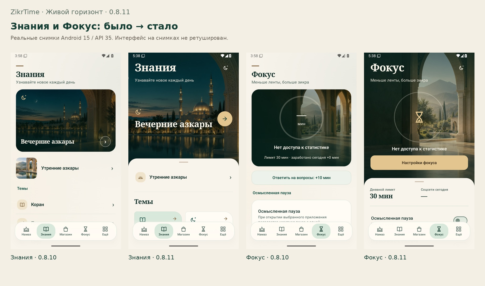
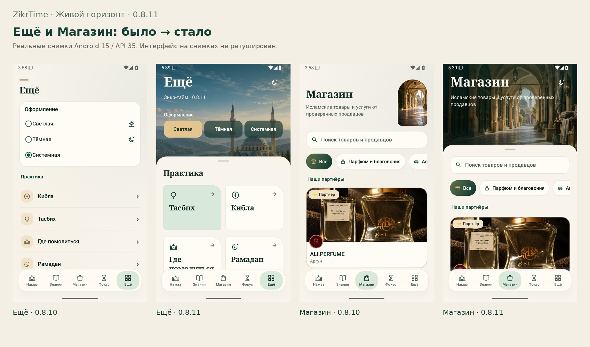
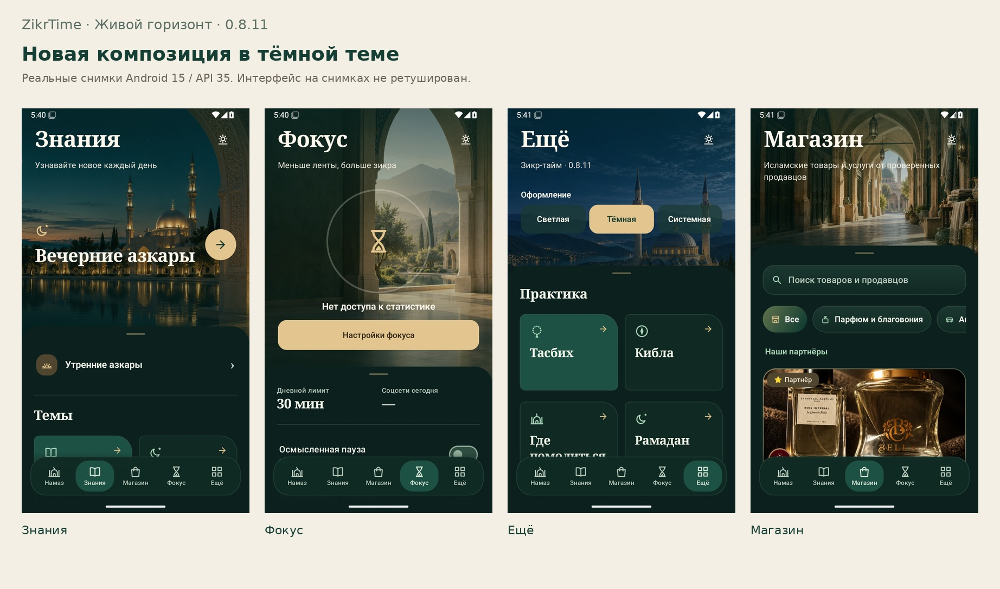
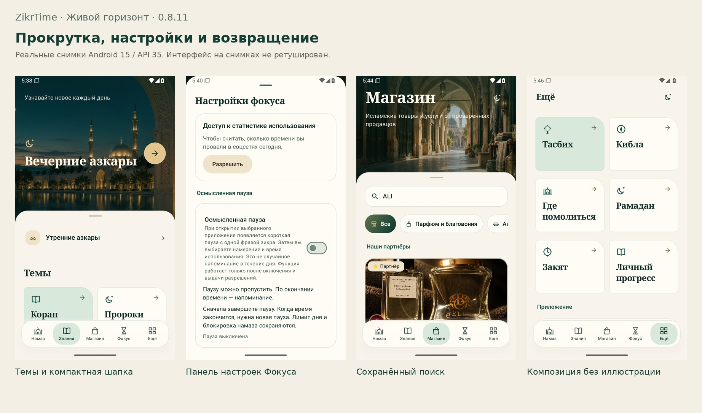
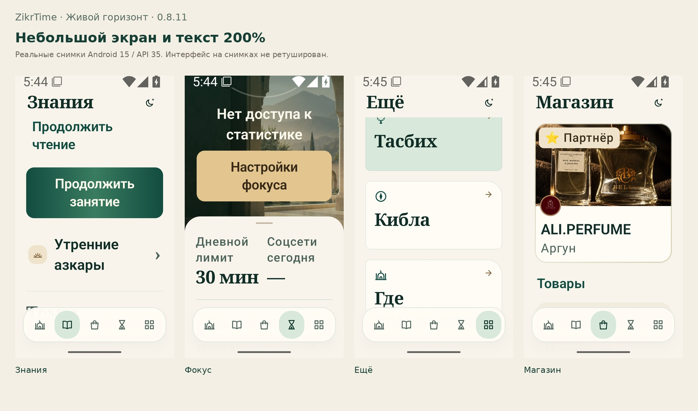
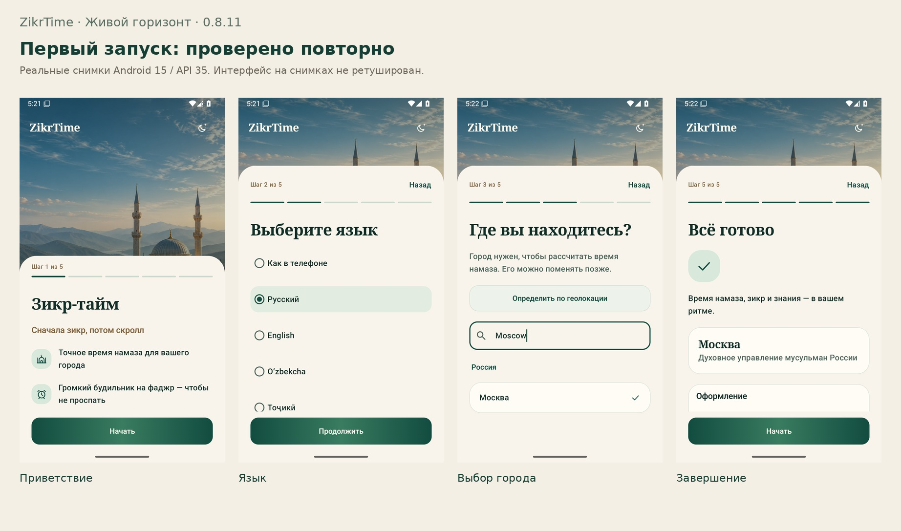
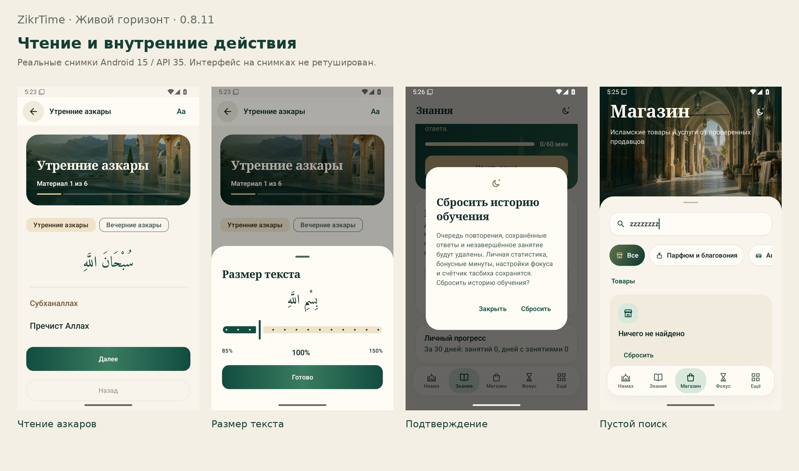

# ZikrTime 0.8.11 — реальные скриншоты и записи

Перестроены четыре вкладки: «Знания», «Фокус», «Ещё», «Магазин». Отдельно создана панель настроек Фокуса. Главная сохраняет утверждённую композицию.

В каждой паре ниже: **0.8.10 → 0.8.11**. Снимки работающего Android-приложения, без ретуши интерфейса.

## Тёмная тема и прокрутка

## Повторная проверка первого запуска и чтения

Эти экраны сохраняют доработки 0.8.10; они не объявляются заново переработанными в этой итерации. Снимки сделаны в полном прогоне 0.8.11 на коммите 675619b.

## Записи

- [Прокрутка → чтение → возврат → тема, окончательная сборка](reading-scroll.mp4)
- [Чистый первый запуск → главная, полный прогон 675619b](first-run.mp4)

Исходные записи без ускорения и интерполяции. Они показывают реальные переходы; плавность на физическом телефоне ещё требует проверки.

## APK и доказательства

[Скачать артефакты этой сборки](https://github.com/ibragimvisaevv-cloud/ZikrTime/actions/runs/40926418302): **ZikrTime-0.8.11-APK** содержит один установочный APK и контрольную сумму; **ZikrTime-0.8.11-evidence** содержит 134 исходных кадра, записи и результаты проверок.

APK тестовый (debug), 0.8.11 / 23. SHA-256: **e5f801a6b51a96d06b3911ff8ad546f433e5821f27d9f4d7913bf7c34f81cb72**. Совместимость подписи с установленной у пользователя версией не подтверждена; удалять приложение с личными данными ради установки не нужно.

- [Отчёт: изменения, проверки и ограничения](../composition-0811.md)
- [Карта 83 сценариев с отдельными статусами кода и проверки](../app-redesign-map.csv)
- [Точные версии и источники кадров](sources.json)

Android 15 / API 35. 54 unit-теста, 0 ошибок Lint. Полные journeys/focus/accessibility проверены на 675619b; после исправления отрисовки под системными часами build и composition повторены на c45fad4. Первые пять иллюстраций используют окончательные кадры c45fad4. Это не подтверждение iOS, аппаратных датчиков, реальных сигналов по расписанию или совместимости подписи с установленным APK.
