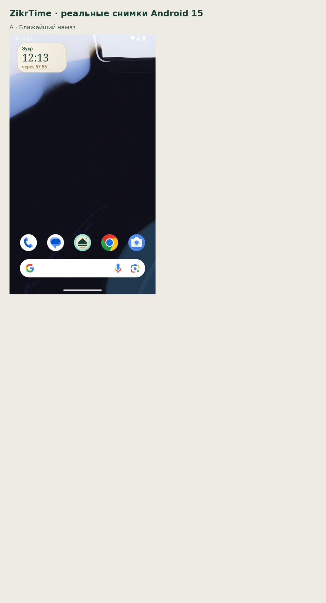
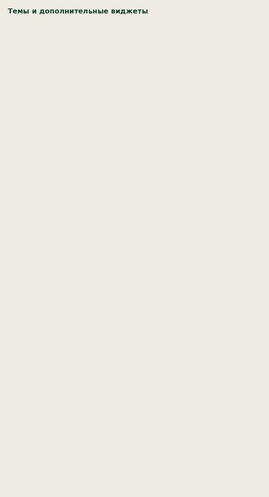

# Виджеты ZikrTime — проверка

Реальные снимки Android 15 / API 35, stock launcher, 1080×1920, 420 dpi.

Сборка: e06eeac24b1c806d2242fcdbecc56f1d63a25411; [прогон 41024626556](https://github.com/ibragimvisaevv-cloud/ZikrTime/actions/runs/41024626556), статус: failure.

[Запись](widgets.mp4). [Иконки и исходники](ZikrTime-icon-concepts.zip).

Это этап проверки. Результаты дополнительных сценариев будут отмечены отдельно. Утверждённый «Купол и горизонт» внедрён в APK. Концептуальные макеты находятся в ../icons; фотографии рабочего стола выше получены в эмуляторе.
